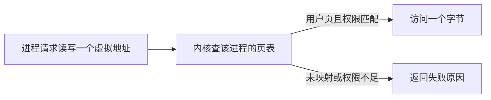

# ch4 用串口认识页表权限

虚拟地址是进程使用的地址。页表把它翻译为可访问的物理地址，并记录该页的权限。`mmap` 建立映射，`munmap` 撤销映射。页表项中的 `U` 表示用户可访问，`R/W/X` 分别表示读、写和执行。RISC-V 要求可写页同时具备可读位。课程测例还会刻意建立只写编码并观察硬件页故障。[RISC-V 特权架构规范](https://docs.riscv.org/reference/isa/priv/supervisor.html)

## 先预测，再运行

设 `0x10000000` 是刚映射的一页，只允许读。分别预测读取、写入、撤销映射后再次读取的结果。整理答案后，在云端项目根目录执行：

```bash
export RUSTUP_TOOLCHAIN=1.100.0
export TG_USER_DIR="$(pwd)/tg-rcore-tutorial-user"
cd tg-rcore-tutorial-ch4
LOG=debug timeout -k 5s 150s bash test.sh exercise </dev/null
```

搜索 `op=trace_write`、`op=munmap`，找到对应的地址。测试包含多个独立进程，相同虚拟地址可能出现在多个用例中。观察 `Test trace_1 OK!` 之前连续几行。



## 分层提示

1. 先看 `addr=` 是否是目标地址，确认它位于同一个用户态测例内。
2. 关注 `permission-denied` 和 `not-user-mapped` 各出现在撤销之前还是之后。
3. 打开 `tg-rcore-tutorial-ch4/src/main.rs`，找 `Trace::trace` 调用 `translate` 时要求的标志位。在 `tg-rcore-tutorial-kernel-vm/src/space/mod.rs` 找撤销映射时清除页表项的代码。

## 复盘与参考答案

<details>
<summary>完成预测后查看</summary>

在租赁服务器实测，`prot=0x1` 建立了只读映射；随后 `trace_read` 返回 `allowed`，`trace_write` 返回 `permission-denied`。执行 `munmap` 后，`trace_read` 返回 `not-user-mapped`。前者有页表项但缺授权，后者已经找不到有效用户映射。

`trace` 访问的是当前进程里翻译得到的物理位置。两个进程拥有独立页表时，相同虚拟地址可以映射到不同物理页。这也是日志中不能仅凭地址把不同行归给同一个进程的原因。

</details>

官方基础测试 6/6，练习测试 16/16。虚存 crate 的宿主机测试注入第二页页表分配失败，确认首个叶子映射撤销，且同一地址可以重试。匿名映射成功后，现有 `unmap` 只撤销页表项，连续物理块回收仍受上游内存管理方式限制。
