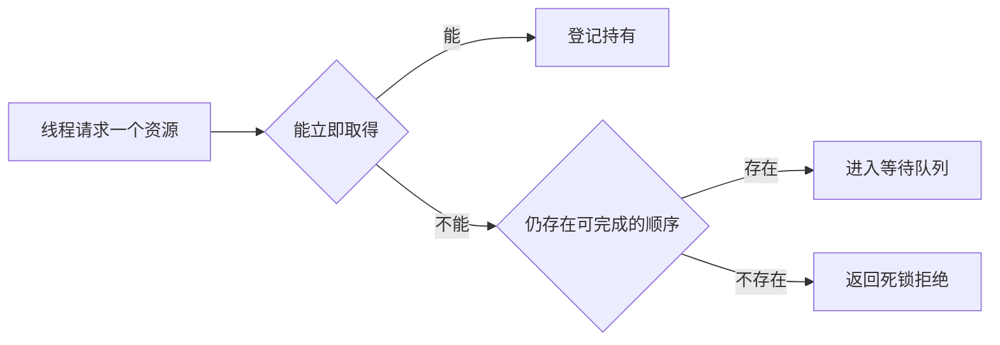

# ch8 用资源状态判断死锁

互斥锁保护共享数据。信号量可以代表多个同类资源。本实验按进程分别维护两类资源的可用量、线程持有量和等待项。

## 先判断，再查看证据

一个线程已经持有锁 A，又请求同一把锁。假设只有它能释放 A，在锁被占用时，谁能先完成？

在项目根目录运行：

```bash
export RUSTUP_TOOLCHAIN=1.100.0
cargo test --manifest-path tg-rcore-tutorial-ch8/Cargo.toml --target x86_64-unknown-linux-gnu deadlock::tests
LOG=debug bash scripts/test_proj20.sh ch8
```

在脚本给出的 `ch8-exercise.log` 中找 `kind=mutex` 与 `decision=reject-deadlock`。接着比较信号量测例中哪些请求以 `waiting` 等待后继续，哪些返回了死锁拒绝。跟踪记录来自内核处理同步请求的位置。



## 分层提示

1. 先读日志里的资源编号、线程编号和内核决定。
2. 在纸上列出可用量、持有量和当前等待。把能完成线程的持有量归还，再看是否有下一个线程能完成。
3. 对照 `tg-rcore-tutorial-ch8/src/deadlock.rs` 的 `would_deadlock`。检查拒绝发生在调用真实同步原语之前还是之后。

<details>
<summary>完成预测后核对</summary>

同一线程继续等待自己持有的唯一锁时，没有其他线程可以归还这个锁，内核返回 `-0xDEAD`。拒绝发生在真正入队之前，因此线程能收到错误并继续执行解锁。信号量有多份资源时，若至少一个线程还能先完成并归还资源，其他线程的请求仍有机会被满足，合法等待应继续执行。

一次实测串口事件如下。线程编号随每次运行而变化。

```text
sync kind=mutex tid=119 resource=0 decision=reject-deadlock
```

</details>

开关仅影响当前进程。已有持有量和等待仍然记录，因此启用时能观察已有状态。互斥锁与信号量分开模拟。计算依据当前请求与可用量，不推断未来申请。信号量也可由未持有者发出信号，等待者未持有资源时允许入队。跨类型资源和条件变量组合不在本实验的死锁检测范围。
