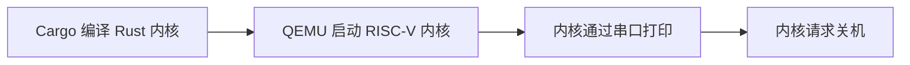

# 第一次启动内核

本节只需要理解三件事。Rust 写的是内核代码，Cargo 负责构建，QEMU 在云端模拟一台 RISC-V 计算机。终端看到的最后一行来自模拟机串口。

在已经安装 Rust 和 QEMU 的云端终端运行：

```bash
cd /workspaces/proj20/tg-rcore-tutorial-ch1
cargo run
```

看到 `Hello, world!` 后，终端应返回命令提示符。打开 `src/main.rs`，找出负责输出字符和负责关机的两处调用。



## 自查

如果只改变输出文本，先预测哪一行会变，再运行核对。解释为什么打印完成后终端会返回提示符。

<details>
<summary>完成后核对</summary>

内核通过 `console_putchar` 逐字节输出，修改输出字符串会改变串口中的文本。随后 `shutdown(false)` 请求正常关机，QEMU 退出，终端回到提示符。

</details>
